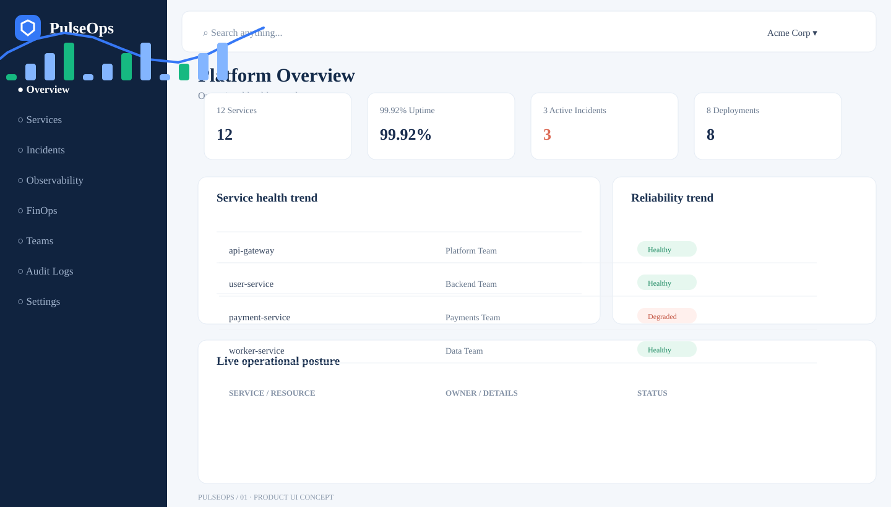
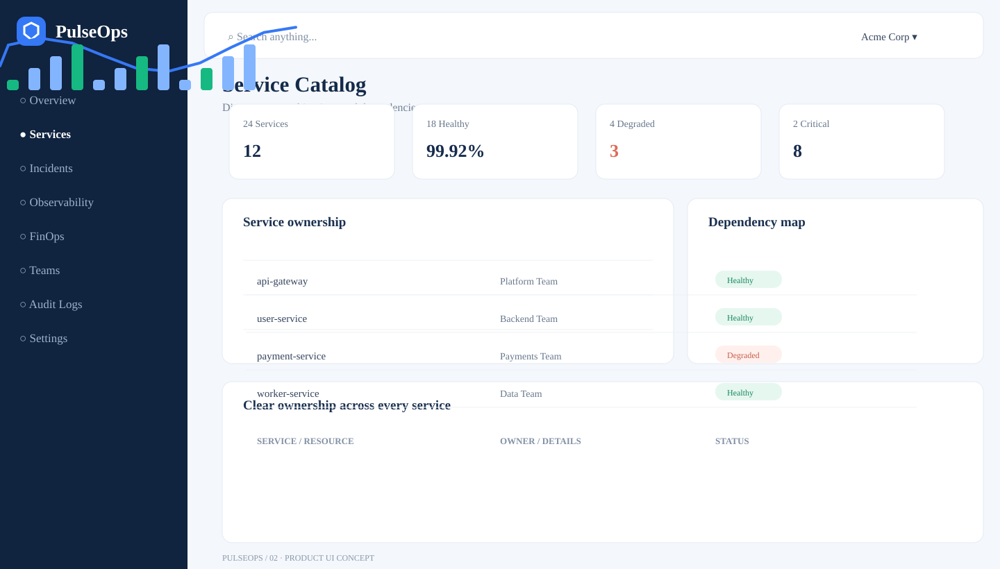
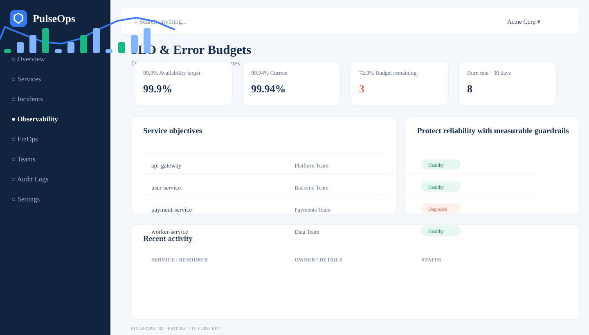
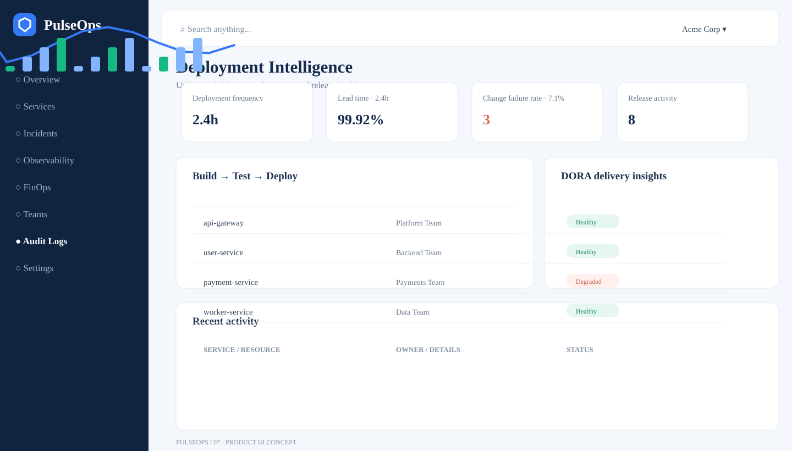
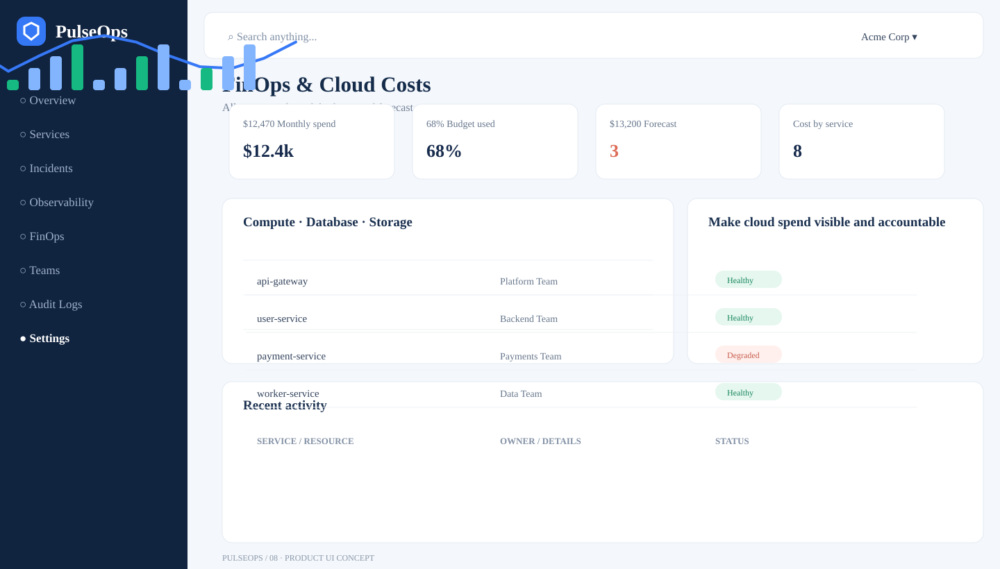
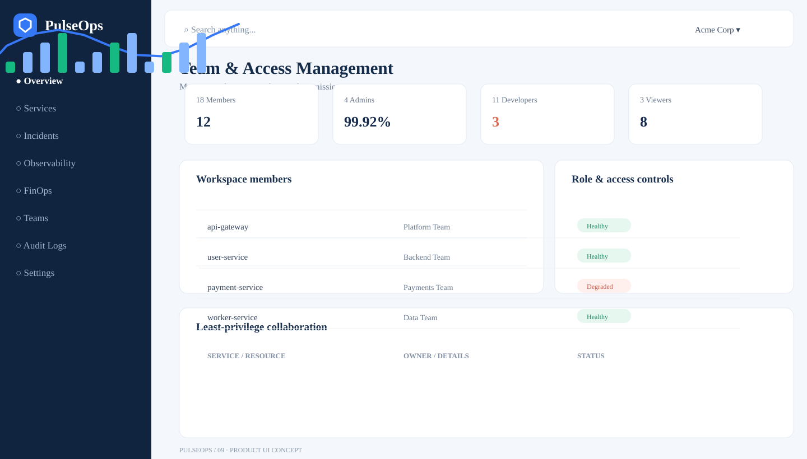

# PulseOps

**An AI-assisted developer platform for cloud operations, observability, incident response, SRE, and FinOps.**

PulseOps brings service ownership, operational signals, incident workflows, reliability objectives, delivery intelligence, and cloud-cost visibility into one engineering workspace.

<p align="center">
  <a href="https://pulse-ops-enterprise-developer-plat.vercel.app"><strong>Live Demo</strong></a>
  ·
  <a href="docs/ARCHITECTURE.md"><strong>Architecture</strong></a>
  ·
  <a href="docs/ROADMAP.md"><strong>Roadmap</strong></a>
  ·
  <a href="CONTRIBUTING.md"><strong>Contributing</strong></a>
</p>

> **Project status:** This is an actively developed portfolio project, not a production-ready managed service. The repository contains working application slices alongside integrations and capabilities that are still planned or require external configuration. The live demo may not have every backend dependency configured; use test data only.

## At a glance

| Area | Current implementation |
| --- | --- |
| Web application | Next.js 15, React 19, TypeScript |
| API | NestJS 10, TypeScript |
| Data layer | PostgreSQL 16, Prisma 6 |
| Local infrastructure | Docker Compose, Redis |
| Authentication | JWT access tokens, rotating refresh sessions, server-side revocation |
| Authorization | Workspace isolation and ADMIN/MEMBER roles |
| Quality | Jest, PostgreSQL integration tests, Playwright, GitHub Actions |

## What works today

- **Workspace and access management** — registration and sign-in, tenant-scoped service and team management, invitations, role changes, membership removal, and ADMIN/MEMBER authorization.
- **Service catalog** — service ownership, criticality, and tenant-scoped dependency relationships with cycle prevention.
- **Incident workflows** — incident creation, assignment, acknowledgement, resolution, timeline events, and audited manual escalation.
- **Reliability workflows** — persisted service-level indicators and objectives, rolling-window calculations, error-budget reporting, SLO alert rules, and transactional outbox processing. SLI samples are ingested manually.
- **Observability foundation** — structured HTTP request logs, trace ID propagation, W3C trace context, optional OTLP/HTTP span export, and Prometheus-compatible process metrics.
- **Delivery intelligence** — GitHub webhook ingestion for merged pull requests and deployment statuses, plus DORA calculations with sample sizes and documented definitions.
- **FinOps foundation** — normalized cost-record imports, service allocation, workspace/service budgets, and manual budget evaluation.
- **Operational governance** — append-only audit events, service runbook references, escalation policies, and an ADMIN-only audit viewer.

### Integration status and limitations

Some workflows are intentionally partial. OTLP export requires an external collector; process metrics are not durably aggregated; SLI samples and budget evaluations are manual; GitHub webhooks require manual setup; and cost imports use normalized JSON rather than provider billing APIs. Email delivery, automatic escalation timers, GitHub App OAuth, managed cloud billing ingestion, and AI-assisted incident analysis/remediation are not currently implemented.

See the [roadmap](docs/ROADMAP.md) for the detailed status of each phase.

## Product UI concepts

The images below are **illustrative dashboard designs** that communicate intended workflows. They are not evidence that every screen or integration is fully implemented.

<details>
<summary><strong>Explore the dashboard gallery</strong> (12 concepts)</summary>

### Platform overview


### Service catalog and dependencies


### Incident command center


### SLOs and error budgets


### Observability explorer


### Alert management


### Deployment intelligence


### FinOps and cloud costs


### Team and access management


### Audit and security


### Runbooks and escalation


### Platform settings and integrations


</details>

## Tech stack

| Layer | Technologies |
| --- | --- |
| Frontend | Next.js 15, React 19, TypeScript |
| Backend | NestJS 10, TypeScript |
| Database and ORM | PostgreSQL 16, Prisma 6 |
| Local services | Docker Compose, Redis |
| Testing | Jest, ts-jest, Playwright |
| CI | GitHub Actions |
| Observability | Structured logs, Prometheus exposition, W3C trace context, optional OTLP/HTTP |

## Run locally

### Prerequisites

- Node.js 20+
- pnpm 10 (the repository specifies pnpm 10.4.1)
- Docker Engine or Docker Desktop with Compose

### Setup

```bash
# Install dependencies
pnpm install

# Create local environment files
cp .env.example .env
cp apps/api/.env.example apps/api/.env

# Start PostgreSQL and Redis
docker compose up -d postgres redis

# Configure a strong local JWT_SECRET in apps/api/.env.
# Never use the example secret outside local development.

# Generate Prisma Client and validate the schema
pnpm db:generate
pnpm --filter @pulseops/api prisma:validate

# Apply database migrations
pnpm --filter @pulseops/api prisma:migrate
```

Start the API and web application in separate terminals:

```bash
pnpm dev:api
pnpm dev:web
```

| Service | Local URL |
| --- | --- |
| Web application | http://localhost:3000 |
| API liveness | http://localhost:4000/api/v1/health |
| API readiness | http://localhost:4000/api/v1/ready |

For browser tests, install Playwright Chromium first:

```bash
pnpm --filter @pulseops/web exec playwright install chromium
```

## Tests and quality gates

Run the available test suites from the repository root:

```bash
# API unit tests
pnpm test:api

# PostgreSQL integration tests
pnpm test:integration

# Browser / end-to-end tests
pnpm test:browser

# Build all workspace packages that define a build script
pnpm build
```

The GitHub Actions quality workflow provisions PostgreSQL, applies versioned migrations, runs API unit and integration tests, builds the applications, and executes Playwright browser tests. Integration tests use a dedicated Jest configuration and are separate from the faster unit-test command.

## API surface

The API is versioned under `/api/v1`. Main resource areas include:

- **Authentication:** `/auth`
- **Services and dependencies:** `/services`, `/service-dependencies`
- **Teams and members:** `/teams`, `/members`
- **Incidents and audit events:** `/incidents`, `/audit-logs`
- **Reliability:** `/slos`
- **Metrics:** `/metrics`
- **GitHub integration and DORA metrics:** `/integrations/github`, `/engineering-metrics/dora`
- **Cost records and budgets:** `/finops`

See [API conventions and endpoint details](docs/API.md) for request behavior, authorization, and limitations.

## Configuration and security

Environment variable examples are maintained alongside each application:

- Root: `.env.example`
- API: `apps/api/.env.example`
- Web: `apps/web/.env.example`

Keep real credentials in local environment files or deployment secret stores. Do not commit secrets or production data. The API enforces tenant authorization server-side; client-supplied tenant identifiers are not trusted.

Additional details: [Security model](docs/SECURITY.md).

## Documentation

- [Architecture and system boundaries](docs/ARCHITECTURE.md)
- [Database design](docs/DATABASE.md)
- [API conventions](docs/API.md)
- [Security model](docs/SECURITY.md)
- [Deployment strategy](docs/DEPLOYMENT.md)
- [Roadmap and implementation status](docs/ROADMAP.md)
- [Contribution guidelines](CONTRIBUTING.md)

## Live demo

**[Open the PulseOps demo](https://pulse-ops-enterprise-developer-plat.vercel.app)**

The demo points to the deployed frontend. Features that depend on the API, database, email, file storage, or other external services may require corresponding backend services and environment variables to be configured. This is a portfolio demonstration, not a production service.

## Engineering principles

1. Build tested vertical slices before splitting into distributed services.
2. Enforce authorization in the API, not only in the UI.
3. Label live, illustrative, and planned integrations honestly.
4. Require human approval for risky production actions.
5. Design for least privilege, auditability, and secure secret handling.
6. Instrument services with useful logs, metrics, and traces.

## License

No license has been selected yet. Until a license is added, all rights are reserved by the repository owner.
