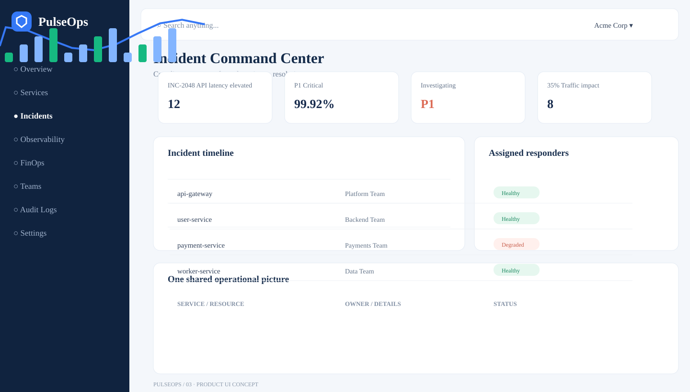
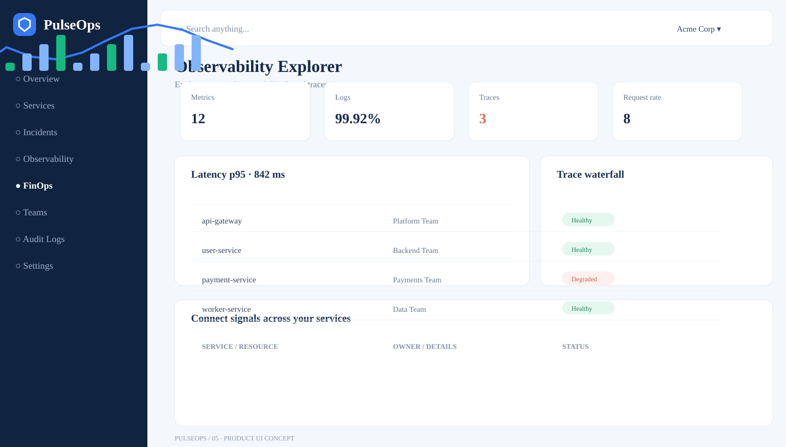
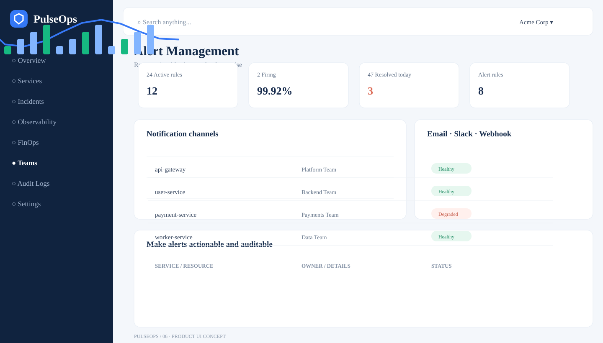
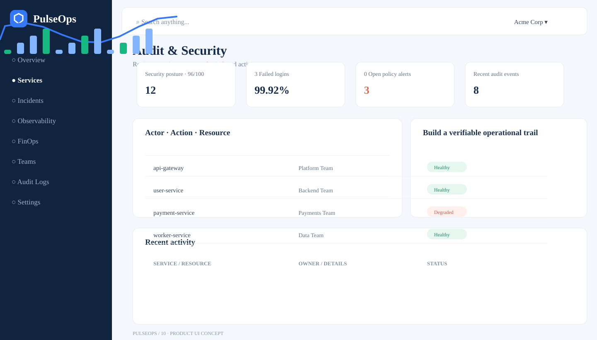
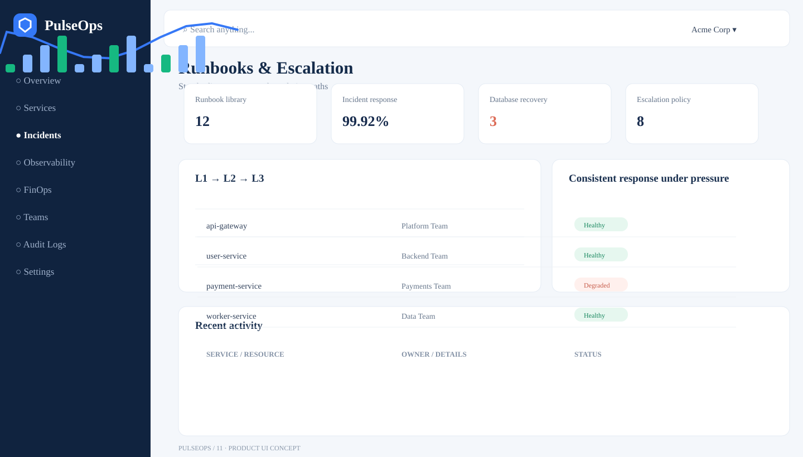
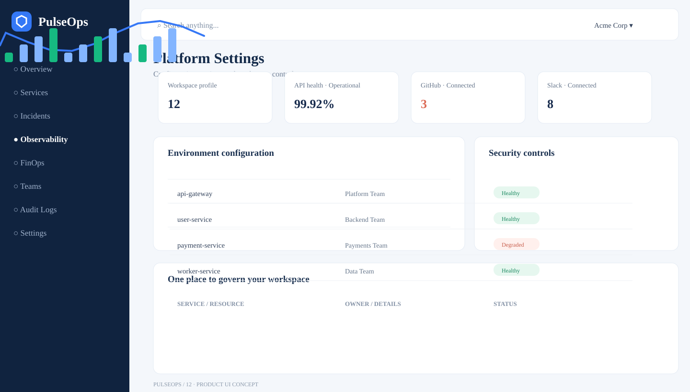

# PulseOps

**An AI-assisted developer platform for cloud operations, observability, incident response, SRE, and FinOps.**

PulseOps brings service ownership, operational signals, incident workflows, reliability objectives, and cloud-cost visibility into one engineering workspace.

> **Project status:** The repository includes a Next.js portal, NestJS API, PostgreSQL/Prisma schema, JWT authentication with rotating refresh sessions and server-side session revocation, database-backed authentication rate limits, security headers, tenant-scoped Service Catalog and Team Management, workspace invitations, ADMIN/MEMBER RBAC, incident lifecycle management, append-only audit events, service dependency graph, SLI/SLO and error budgets, Prometheus-compatible process metrics, W3C trace context with optional OTLP export, tenant-scoped SLO alerting with a PostgreSQL transactional outbox, GitHub webhook-based deployment tracking and DORA metrics, FinOps cost imports and budgets, service runbooks and escalation workflows, and GitHub Actions quality gates for API unit tests, PostgreSQL integration tests, builds, and Playwright browser tests. Some enterprise integrations (such as SAML/SCIM, managed cloud billing ingestion, outbound email, and AI-assisted remediation) remain planned or require external configuration; see the roadmap.

## Product dashboard gallery

The following product UI concepts illustrate the main PulseOps workflows. They are **illustrative dashboard designs**, not claims that every screen or integration is currently live. Each dashboard is shown at full width in a single vertical column for easy browsing.

### 1. Platform Overview
A unified view of service health, uptime, active incidents, and delivery activity.

### 2. Service Catalog & Dependencies
Discover services, ownership, criticality, health, and upstream/downstream relationships.

### 3. Incident Command Center
Coordinate severity, impact, responders, investigation progress, and incident timelines.

### 4. SLO & Error Budgets
Track availability objectives, error-budget consumption, and reliability burn rates.

### 5. Observability Explorer
Explore metrics, logs, latency, and distributed trace context in one workspace.

### 6. Alert Management
Review alert rules, active notifications, resolved events, and delivery channels.

### 7. Deployment Intelligence
Understand deployment frequency, lead time, change failure rate, and release flow.

### 8. FinOps & Cloud Costs
Review service-level cost allocation, budget utilization, and spending forecasts.

### 9. Team & Access Management
Manage workspace members, roles, and least-privilege access at a glance.

### 10. Audit & Security
Inspect security posture and a searchable trail of privileged workspace activity.

### 11. Runbooks & Escalation
Keep operational procedures and escalation paths close to incident workflows.

### 12. Platform Settings & Integrations
Configure workspace details, integration status, environments, and security controls.

## Current stack
- **Web:** Next.js 15, React 19, TypeScript
- **API:** NestJS 10, TypeScript
- **Data:** PostgreSQL 16, Prisma 6
- **Local infrastructure:** Docker Compose, Redis
- **CI:** GitHub Actions, Jest, ts-jest

## Prerequisites
- Node.js 20 or newer
- pnpm 10
- Docker Engine/Desktop with Compose

## Local setup
1. Install dependencies: `pnpm install`.
2. Create local environment files: `cp .env.example .env` and `cp apps/api/.env.example apps/api/.env`.
3. Start PostgreSQL and Redis: `docker compose up -d postgres redis`.
4. Set a strong local `JWT_SECRET` in `apps/api/.env`. Never use the example value outside local development.
5. Generate Prisma Client and validate: `pnpm db:generate` and `pnpm --filter @pulseops/api prisma:validate`.
6. Apply migrations: `pnpm --filter @pulseops/api prisma:migrate`.
7. Run API unit tests: `pnpm test:api`.
8. Run PostgreSQL integration tests: `pnpm test:integration` (requires the migrated test database in `DATABASE_URL`).
9. Run browser tests: `pnpm test:browser` (requires the API and web app running, plus Playwright Chromium installed with `pnpm --filter @pulseops/web exec playwright install chromium`).
10. Start API and web in separate terminals: `pnpm dev:api` and `pnpm dev:web`.

## Local endpoints
- Web: http://localhost:3000
- API liveness: http://localhost:4000/api/v1/health
- API readiness: http://localhost:4000/api/v1/ready
- Authentication: `POST /api/v1/auth/register`, `POST /api/v1/auth/login`
- Service Catalog: `GET/POST/PATCH/DELETE /api/v1/services` (Bearer token required)
- Teams: `GET/POST/PATCH/DELETE /api/v1/teams` (Bearer token required; writes require ADMIN)
- Members: `GET /api/v1/members`, `POST /api/v1/members/invitations`, `PATCH /api/v1/members/:userId/role`, and `DELETE /api/v1/members/:userId` (administrative actions require ADMIN).
- Invitation acceptance: `POST /api/v1/auth/accept-invitation` (single-use seven-day token; email delivery is not configured yet).
- Incidents: `GET/POST /api/v1/incidents`, `PATCH /api/v1/incidents/:id/assign`, and `POST /api/v1/incidents/:id/acknowledge` or `/resolve`.
- Audit trail: `GET /api/v1/audit-logs` (ADMIN only; records privileged workspace and incident actions).
- Service dependencies: `GET/POST/DELETE /api/v1/service-dependencies` (writes require ADMIN; cycle prevention enabled).
- SLOs: `GET /api/v1/slos`, `POST /api/v1/slos/services/:serviceId`, `POST /api/v1/slos/:id/samples`, and `DELETE /api/v1/slos/:id` (writes require ADMIN; sample ingestion is manual).
- Metrics: `GET /api/v1/metrics` (Prometheus exposition; `METRICS_TOKEN` required in production).
- GitHub: `POST /api/v1/integrations/github/repositories`, `GET /api/v1/integrations/github/repositories`, `DELETE /api/v1/integrations/github/repositories/:id`; webhook receiver `POST /api/v1/integrations/github/webhook`.
- DORA: `GET /api/v1/engineering-metrics/dora?windowDays=30` (7–90 day window; requires connected GitHub repositories and configured webhooks).
- FinOps: `POST /api/v1/finops/cost-records/import`, `GET /api/v1/finops/costs`, `GET/POST /api/v1/finops/budgets`, and `POST /api/v1/finops/budgets/evaluate` (normalized JSON imports; no cloud billing API integration yet).\n- Runbooks: `GET/POST /api/v1/services/:serviceId/runbooks` and `DELETE /api/v1/services/:serviceId/runbooks/:runbookId` (mutations require ADMIN).
- Escalation: `GET/PUT /api/v1/services/:serviceId/escalation-policy` and `POST /api/v1/incidents/:id/escalate` (policy writes require ADMIN; escalation is manually triggered and audited).

The readiness endpoint checks PostgreSQL and returns HTTP 503 if the database is unavailable. Team and service APIs derive workspace scope from the verified JWT; clients cannot override tenant IDs.

## Automated quality gates

The `Quality Gates` GitHub Actions workflow provisions PostgreSQL 16, generates Prisma Client, applies all versioned Prisma migrations to an isolated CI database, runs API unit and PostgreSQL integration tests, builds both applications, and executes Playwright Chromium tests against the running API and web UI. The browser suite covers workspace registration/sign-in, Team Management CRUD, service ownership assignment, workspace invitations, member read-only access, Service Catalog CRUD, incident acknowledgement/resolution, dependency graph creation, SLO creation and sample recording, and the ADMIN audit viewer. Team and Service operations use the authenticated workspace-scoped API.

Integration tests use a dedicated Jest configuration and are intentionally excluded from the fast unit-test command.

## Environment variables
See the root `.env.example`, `apps/api/.env.example`, and `apps/web/.env.example`. Environment files are local-only and must not be committed.

## Planned capabilities
- Cloud cost import and allocation
- Metrics, logs, and traces
- Runbook references and escalation metadata
- SLI/SLO and error-budget tracking
- FinOps and cloud cost allocation
- AI-assisted incident analysis with human-approved remediation

See [ROADMAP.md](docs/ROADMAP.md) for implementation status. Planned features are not represented as completed functionality.

## Engineering principles
1. Build tested vertical slices before splitting into distributed services.
2. Label live, mocked, and planned integrations honestly.
3. Enforce authorization in the API, not only in the UI.
4. Require human approval for risky production actions.
5. Design for least privilege, auditability, and secure secret handling.
6. Instrument services with logs, metrics, and traces.

## Documentation
- [Architecture](docs/ARCHITECTURE.md)
- [Database design](docs/DATABASE.md)
- [API conventions](docs/API.md)
- [Security model](docs/SECURITY.md)
- [Deployment strategy](docs/DEPLOYMENT.md)
- [Roadmap](docs/ROADMAP.md)
- [Contributing](CONTRIBUTING.md)

## License
A license has not yet been selected. Until one is added, all rights are reserved by the repository owner.

### GitHub webhook setup for delivery intelligence

Connect a service to its GitHub repository as an ADMIN, set `GITHUB_WEBHOOK_SECRET` in the API environment, and configure the repository's webhook to send JSON `pull_request` and `deployment_status` events to `/api/v1/integrations/github/webhook`. The DORA endpoint returns null for metrics without sufficient source data; see [API documentation](docs/API.md) for metric definitions and limitations.

Service-linked incidents can be escalated manually through the API. The selected escalation contact is recorded in the incident timeline and audit log; external notification delivery and automatic timers are intentionally not claimed yet.

## Live Demo

**Frontend:** [Open Live Demo](https://pulse-ops-enterprise-developer-plat.vercel.app)

> This link points to the deployed frontend. Features that depend on the API, database, email, file storage, or other external services may require the corresponding backend services and environment variables to be configured. Use test data only; this demo is not a production service.
