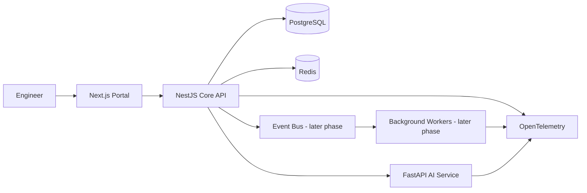

# Architecture

## Status and scope

This document describes the target architecture. The current repository is a foundation scaffold; the services below are design boundaries, not claims that all components already exist.

## Architectural principles

- Start with a modular monolith for the core business API; split services only when operationally justified.
- Keep AI inference behind a dedicated interface and never let model output directly execute privileged actions.
- Use asynchronous events for work that can be retried or processed independently.
- Make tenant, actor, and correlation context explicit across requests and events.
- Instrument the system with structured logs, metrics, and traces from the beginning.

## Logical view

## Main boundaries

| Component | Responsibility | Initial approach |
| --- | --- | --- |
| Web portal | Service catalog, operational views, workflows | Next.js app |
| Core API | Authenticated domain APIs and authorization | NestJS modular monolith |
| AI service | Explanations, summaries, anomaly context | FastAPI service, isolated |
| PostgreSQL | Durable domain data and audit records | Primary datastore |
| Redis | Cache, rate-limit counters, short-lived coordination | Optional infrastructure dependency |
| Event processing | Retries and asynchronous workflows | Introduce after synchronous slice works |
| Telemetry | Traces, metrics, structured logs | OpenTelemetry conventions |

## Current observability slice

The API currently emits structured JSON HTTP request events, propagates W3C trace IDs when supplied (or creates a trace ID), and exposes process-local Prometheus request counters and duration histograms at `/api/v1/metrics`. These are lightweight process metrics, not an OTLP trace pipeline or durable metrics backend. Service-level objectives are persisted per service and calculated from authenticated SLI sample ingestion; production traffic is not yet automatically mapped to service SLI events.

Service dependencies are stored as tenant-scoped directed edges. The API rejects self-edges and detects cycles before insertion.

## Request flow

1. The browser sends an authenticated request to the API.
2. The API validates input, resolves tenant and actor context, and authorizes the operation.
3. Domain logic reads or writes PostgreSQL within a transaction.
4. An outbox record is written in the same transaction when an event must be published.
5. A worker publishes and processes events with idempotency and retry policies.
6. Telemetry records request, dependency, and workflow outcomes.

## Reliability and failure handling

- Set explicit timeouts on network calls.
- Retry only transient failures, with bounded exponential backoff and jitter.
- Use idempotency keys for externally retried write operations.
- Use a transactional outbox when database writes and event publication must stay consistent.
- Define dead-letter handling and operator replay procedures before enabling asynchronous production workflows.
- Degrade optional AI features without blocking core incident and service-management workflows.

## Security boundaries

- Enforce authorization in the API, not only in the UI.
- Scope every tenant-owned record and query by tenant.
- Keep secrets in deployment secret stores; never commit real credentials.
- Require explicit human approval for disruptive or privileged remediation.
- Record actor, action, target, timestamp, and outcome in the audit trail.
